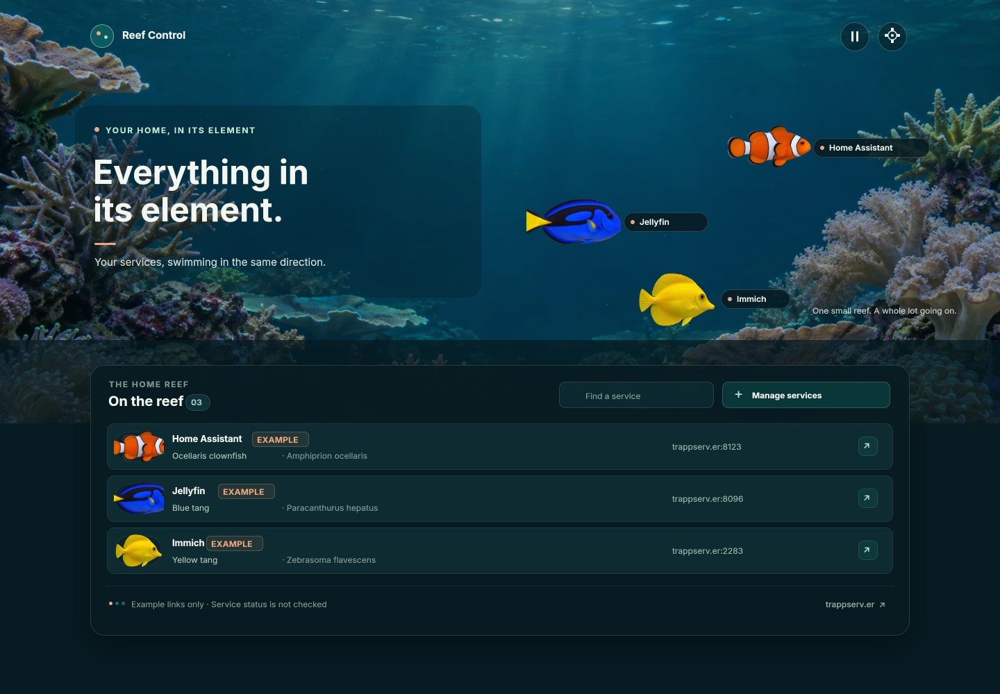

# Reef Control

A playful, reef-inspired launcher for services on your home network.

## Run locally

```sh
npm install
npm run dev
```

The app runs in the browser and keeps service settings in that browser's local storage. Settings are not sent to a server and do not sync to other browsers or devices. Use the app's JSON export and import to move a configuration between browsers.

The initial shortcuts are labeled examples. Their links use `trappserv.er` with example ports; they are placeholders and do not indicate that those services exist or are online. The launcher does not check service health.

## Design

The current editable OpenPencil design is [design/reef-control-v2.fig](design/reef-control-v2.fig), with the [main aquarium preview](design/reef-control-v2-preview.png), the [On the reef modal preview](design/reef-control-v2-modal-preview.png), and the [reproducible builder script](design/build-openpencil.js). The original concept remains in [design/reef-control.fig](design/reef-control.fig) with its [preview](design/reef-control-preview.png).

The builder was verified with OpenPencil CLI `@open-pencil/cli` version `0.16.0`. From the repository root, rebuild the artboard and preview with:

```sh
npm exec --yes --package=@open-pencil/cli@0.16.0 -- openpencil eval design/reef-control-v2.fig --stdin --write < design/build-openpencil.js
npm exec --yes --package=@open-pencil/cli@0.16.0 -- openpencil export design/reef-control-v2.fig --page 'Main aquarium' --format png --output design/reef-control-v2-preview.png
npm exec --yes --package=@open-pencil/cli@0.16.0 -- openpencil export design/reef-control-v2.fig --page 'On the reef modal' --format png --output design/reef-control-v2-modal-preview.png
```

The builder reads its image assets from relative `public/` paths, so these commands work from a repository checkout.



## Project checks

```sh
npm run typecheck
npm test
npm run build
```

## Backlog

Project work is tracked in `backlog/` with the Backlog.md CLI. At the start of a work session, read the workflow overview with `npm run backlog -- instructions overview`. List open tasks with `npm run backlog -- task list --plain`, inspect one with `npm run backlog -- task view AQ-2 --plain`, and use `npm run backlog -- task edit ...` to update status, plans, notes, or acceptance criteria. Start with AQ-1/2/3 for the first-pass app; AQ-4 onward are follow-up work. Delegate implementation to Luna with high reasoning effort and mark tasks Done only after root review.
