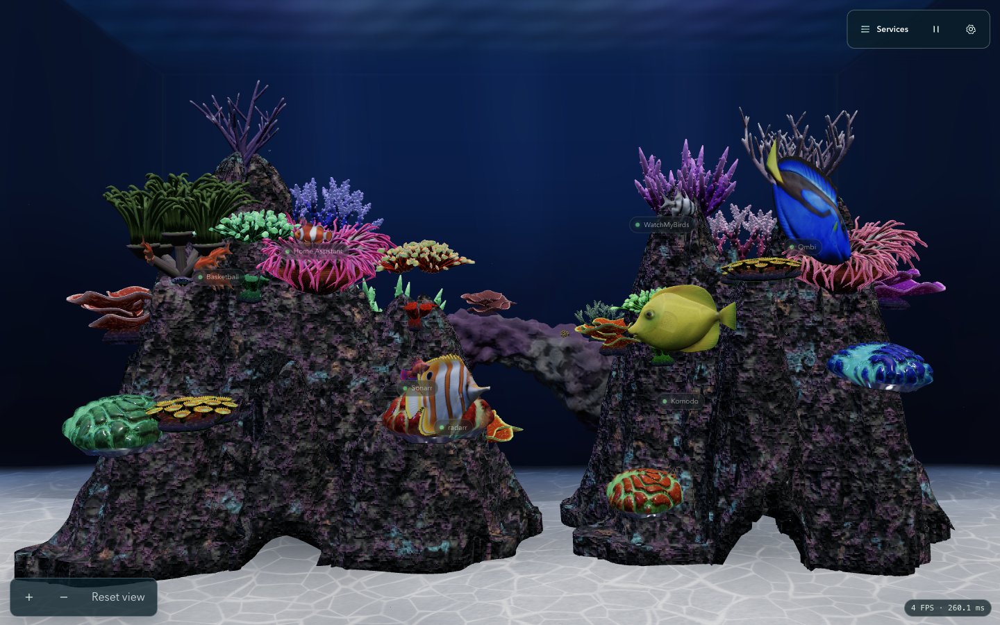
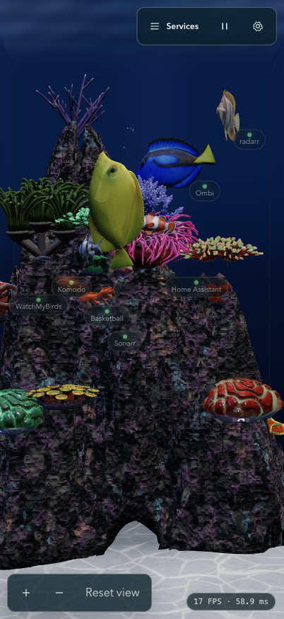

# AQ-105 final Root acceptance

<!-- AGENT_DOC_METADATA
Category: Evidence
Status: Active
Authority: Evidentiary
Backlog: AQ-105
Owner: @root
Updated: 2026-11-14
Upstream: AGENTS.md, docs/asset-evidence/aq105/README.md
Downstream: src/rendering/scene/anemone-host.ts, src/rendering/scene/motion.ts, src/rendering/scene/reef-mesh-navigation.ts
-->

> [!NOTE]
> **Agent Context & Authority** — Root accepts all four AQ-105 criteria at source `4df19dee01ccf4e95a49904bfa51eb3a71730ba4`. This bounded behavior review does not certify final reef/fish art, physical calibration, full animated body envelopes or runtime budgets. Those existing tasks remain open.

## Reproduction and source

The normal app ran from the detached proof checkout at this exact commit on owned localhost port5215. Its sole tracked difference was Vite's filesystem allowlist. [Source concordance](source-concordance.json) verifies395 tracked runtime inputs against the original checkout, including assets. A disposable service configuration changed only URLs to localhost review destinations; the user's original configuration was untouched.

Chrome native captures used1440×900 and402×874 CSS pixels, DPR1. [Raw observations](review.json) retain approach, joint pose, controls and all captured logging, including earlier short probes. Read-only conditional debugger logpoints observed actual controller locals after pose updates without pausing execution. They were removed, emulated media/viewport reset, and only the owned review tab and local destination popup closed. Instrumentation affects wall-clock frame rate, so these observations make no performance claim. No deployed environment, Blender model or production bridge was modified.

Run `python3 docs/asset-evidence/aq105/final-4df19de/summarize.py` to reproduce [summary.json](summary.json). It asserts visibility, target-transform holds/resumption, finite articulated poses, same-host residence, dialog containment and exact PNG dimensions/hashes. The laptop summary uses the entire captured60-sample joint window; the phone summary uses the explicitly retained200-sample settled window. All other raw samples remain available rather than being discarded.

## Criterion evidence

| Criterion | Objective evidence and Root result |
|---|---|
|1: actual crown target, both layouts, invalid unavailable | Loader-faithful actual-asset tests cover current laptop left/right and phone placements, transformed crown measurements, and missing/malformed geometry. A shared-template laptop-to-phone rebuild is also covered. Native host points follow the actual mounted left crown in both layouts. |
|2: enter, remain through idle/swim, bob/peek/return, safe absence/blockage | Both native windows remain at the same left BTA host with clear resident point checks and idle/swim transitions. Laptop131.733–137.633active seconds spans0.25077X/0.06654Y/0.26923Z, maximum home distance0.26903legacyunits. Phone157.767–169.300seconds spans0.22371X/0.07029Y/0.24342Z, maximum distance0.24270. All8 observed spine/pectoral bones vary with finite poses. Actual-asset60second fixtures check every swept segment, safe approach/residence and no lost authored cycle; blocked/unavailable-anchor tests retain safe free routes without fabricated contact. |
|3: solid geometry, water bounds, budgets, other species | Focused mesh/motion tests retain rigid rock, unrelated coral, generic anemone exclusion, invalid/indeterminate exhausted-budget behavior and depth-frustum checks. Only explicitly tagged soft BTA crown/disc meshes are permeable to the resident clownfish. Other-coral boxes include the entire measured shader displacement under nonuniform/sheared transforms; unmeasured geometry retains the conservative sphere fallback. Existing distribution regressions remain unchanged and pass. |
|4: Root tests, native art/motion/links/controls |54focused checks and875tests/75files pass; typecheck including16script checks and productionbuild pass at this source. Logs linked in the parent review. Both visible pages change8of8target transforms during60rAF normal windows and0of8during60rAF Pause/reduced-motion windows. Phone settled paused PNG pair is byte-identical. Native rig motion is proven by the joint traces; automated actual-controller tests separately cover pose/clip freeze. Services and Settings each show8entries within the viewport in both sizes. The clownfish Home Assistant link opens the expected localhost URL in a new tab. Captured final warning/error window is empty. |

The native control probes explicitly record `document.hidden=false` and `visibilityState=visible` at both ends. Earlier12-frame probes without visibility flags are retained as historical observations, not the acceptance basis. The initial unsettled Pause image pair differed; the subsequently settled pair is identical and both images are retained. A30second observation timeout during instrumented capture was followed by successful live observations; it was not treated as app termination.

The controller still uses a0.04legacy-unit navigation capsule and existing approach clearances. These are technical probes, not measured fish-body envelopes. The supplied bubble-tip anemone is reused without asserting that it is a documented wild ocellaris host species. Broader species-reference/art work remains under AQ-18/AQ-70; no task is closed from these separate gates.

## Native views

