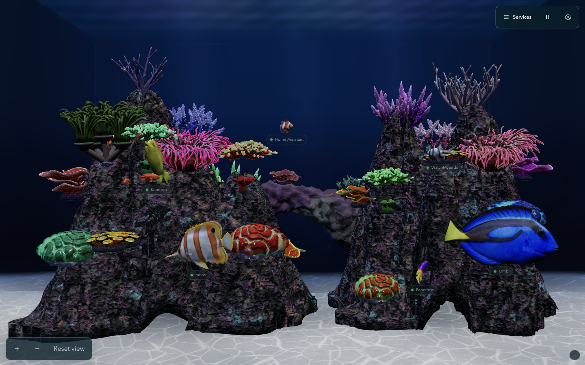
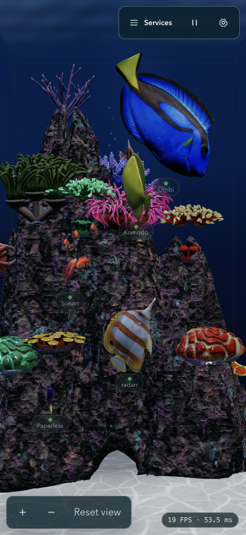

# AQ-89 Root native review

<!-- AGENT_DOC_METADATA
Category: Evidence
Status: Active
Authority: Evidentiary
Backlog: AQ-89
Owner: @root
Updated: 2026-11-14
Upstream: AGENTS.md, docs/asset-evidence/aq89/source-review-20261114/README.md
Downstream: src/rendering/scene/aquarium.ts, src/rendering/scene/fish-label-layout.ts
-->

> [!NOTE]
> **Agent Context & Authority** — Root accepts the five AQ-89 criteria at sourcee0def592ead5b15267581f980b196e73850f4dde. The user subsequently stopped phone checks; phone observations here were already collected before that instruction. No further phone verification is required or performed. Whole-project art/performance/physical-body gates remain open.

[Raw observations](review.json) retain all samples, including discarded viewport resets. The exact running module header records the source commit. Native links use a disposable localhost-only service configuration; original settings, models and Blender work were untouched. The owned review tab had already closed during interrupted-turn cleanup; records were preserved from the live review session.

| Criterion | Root evidence |
|---|---|
|1: tight anchoring at the required views | Final uninstrumented PNGs below show measured captions immediately under their fish; source tests cover immediate side placement at frame edges. Current pose includes skin/morph/turn and live flex, independently of enlarged native targets. |
|2: no foreign-body/caption overlap, usable native links |24laptop frames/99visible-caption samples and84settled phone frames/412samples have zero rectangle/body/caption/frame failures. All service and ambient bodies are included. Keyboard Enter on a currently faded WatchMyBirds caption's native link opens its correct localhost URL. Native44px minimum targets remain independent. |
|3: follow, readability, hover/focus/occlusion | Normal60rAF windows move8of8service transforms in each view, including final windows after logging is removed. Visible caption hover opacity increases0.65→1. Keyboard activation retains the named focused link and inspection card. Existing component/focus/occlusion tests pass; the caption solver never changes native-link exposure. |
|4: controls and existing interaction checks | Both visible60rAF Pause and reduced-motion windows hold0of8transform changes. Services and Settings each contain8entries and fit in both recorded target views. A verified402×874DPR1 touch event with navigator.maxTouchPoints=1 opens Komodo's expected URL in a new tab. Only the owned popups were closed.902tests/75files,170focused interaction/quality tests, typecheck16scripts and build pass in the source review. |
|5 and DoD: Root review/model policy | Root inspected both final views and the live behavior, reviewed implementing-agent counterexamples and integration, and explicitly selected the stronger model for the demanding collision-layout work under project policy. Root performs final status acceptance. |

The raw trace includes6frame-containment failures during an intermediate402×900 resize state, before the requested height settled; they are retained rather than counted as passing target evidence. There are also observations at the browser-restored default viewport after a continuation/popup. Those are explicitly retained under `unscopedAfterContinuation`; phone Settings/reduced-motion/touch were repeated at verified402×874DPR1 before the user stopped phone checks. Observation timeouts were followed on the same live handle rather than triggering app restarts.

Read-only debugger logpoints observed actual body rectangles and DOM captions; they were removed and Debugger disabled before final PNGs. Earlier instrumented PNGs are retained separately. These diagnostics affect frame time and do not certify performance. The final warning window could not be collected after automatic tab closure, so no zero-warning claim is made for that window. Full frame-budget work remains under AQ-76/AQ-70.3.

