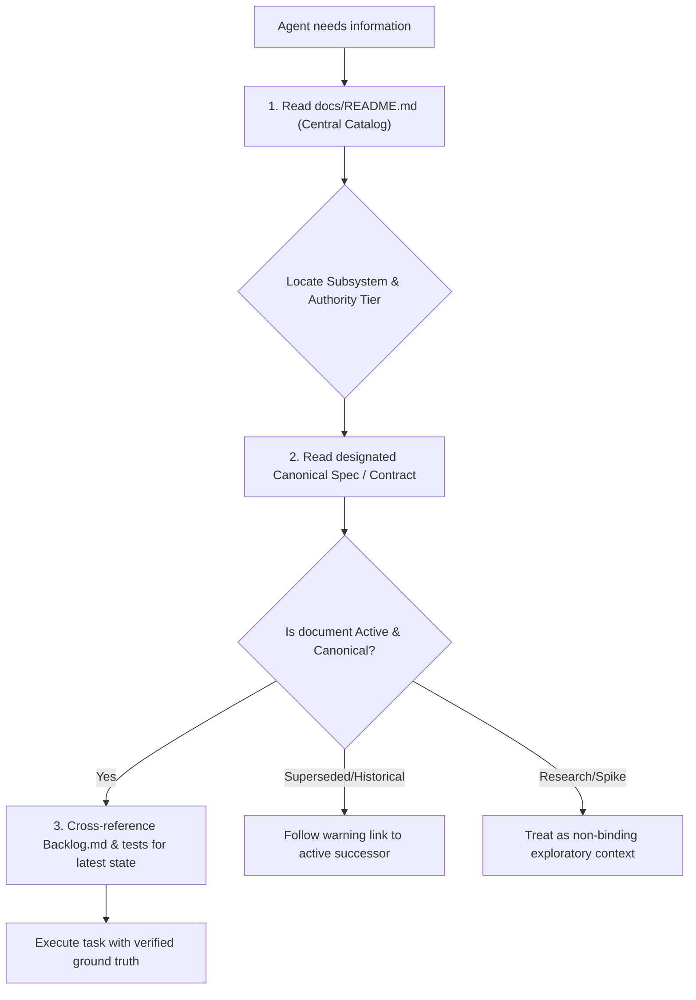

# Agent Documentation Framework & Operating Standard

<!-- AGENT_DOC_METADATA
Category: Framework
Status: Canonical / Active
Authority: Binding Operating Standard for All Agents
Backlog: AQ-61
Owner: @documentation
Updated: 2026-11-05
Upstream: AGENTS.md, AGENT_TASKS.md, docs/requirements.md
Downstream: All files in docs/ and future agent-generated documentation
-->

> [!IMPORTANT]
> **Mandatory Operating Standard for AI Agents**  
> This specification governs how all AI agents (Root, Codex, Gemini, Luna, and subagents) discover, read, author, update, and deprecate documentation across the `aquarium-homepage` repository.  
> **Human readability is a secondary goal; deterministic multi-agent coordination, strict authority hierarchies, and hallucination prevention are primary.**

---

## 1. Core Principles

1. **Single Source of Truth (`docs/README.md`)**:
   Every document in this repository must be cataloged in [`docs/README.md`](../README.md). If a document is not listed in `docs/README.md`, incoming agents cannot assume its validity, status, or lifecycle.

2. **Zero-Deletion Policy**:
   Existing documentation files must **never be deleted**. Historical context, rejected prototypes, and archived audits contain vital negative-knowledge (preventing repeated mistakes). Deprecated or superseded documents are marked with status banners and classified into Historical/Archive categories, never deleted.

3. **Explicit Authority Tiers**:
   Agents must never treat speculative research spikes or historical drafts with the same authority as canonical contracts or verified test fixtures. Every document declares an explicit Authority Tier.

4. **Bi-Directional Traceability**:
   Every technical document must link upstream to its driving Backlog task (e.g., `AQ-40`, `AQ-58`) or governance document (`AGENTS.md`, `docs/requirements.md`), and list downstream code/test consumers.

5. **Code & Fixture Integrity**:
   Certain documents and subdirectories under `docs/` (such as `docs/fish-scale-reference.md` and `docs/asset-evidence/`) serve as direct runtime or test fixtures for Vitest suites. Changing paths or data structures without running tests will break CI/CD.

---

## 2. Document Taxonomy & Authority Tiers

Every document in the repository belongs to exactly one Tier and Category:

| Tier | Category | Authority | Description | Examples |
|---|---|---|---|---|
| **Tier 1** | **Core Governance & Checkpoint** | **Binding** | High-level project constraints, active runtime state, user requirements, and master indexes. | `AGENTS.md`, `AGENT_TASKS.md`, `docs/requirements.md`, `docs/README.md` |
| **Tier 2** | **Canonical Specifications & Contracts** | **Binding** | Formal API schemas, mathematical models, coordinate systems, biological contracts, and testable specifications. | `docs/asset-contract.md`, `docs/behavior-runtime-contract.md`, `docs/fish-scale-reference.md`, `docs/modular-coral-and-live-rock-spec.md` |
| **Tier 3** | **Architecture & Implementation Plans** | **Active** | System designs, subsystem plans, rendering pipelines, and engineering roadmaps. | `docs/rendering.md`, `docs/fish-turning-and-maneuvering-plan.md`, `docs/habitat-navigation-core-contract.md` |
| **Tier 4** | **Audits & Verification Evidence** | **Evidentiary** | Objective validation reports, test fixtures, hash inventories, accessibility reviews, and change logs. | `docs/asset-evidence/*`, `docs/accessibility-audit.md`, `docs/agent-change-audit.md`, `docs/service-mapping-review.md` |
| **Tier 5** | **Operations & Runbooks** | **Operational** | Deployment procedures, server environments, host configurations, and local test harness guides. | `docs/deployment.md`, `docs/socket-verification.md` |
| **Tier 6** | **Research Spikes & Investigations** | **Informational** | Engine evaluations, benchmark tests, external reference reviews, literature surveys. Non-binding. | `docs/sketchfab-motion-review.md`, `docs/mesh2motion-review.md`, `docs/open-source-asset-and-motion-research.md` |
| **Tier 7** | **Historical Archives & Superseded Drafts** | **Historical** | Past proposals, superseded UI designs, unverified AI chat dumps, obsolete prototypes. Retained for audit only. | `docs/design.md`, `docs/archive/deployment-2.md`, `docs/gemini_planning.md`, `docs/reef_aquarium_all_code.md` |

---

## 3. Standard Document Header & Metadata Specification

Every document created or updated by an agent must include a standardized machine-parsable metadata comment block at the very top, followed by an Agent Context banner.

### Standard Format

```markdown
# Document Title

<!-- AGENT_DOC_METADATA
Category: [Governance | Specification | Architecture | Evidence | Runbook | Research | Archive]
Status: [Canonical | Active | Candidate | Historical | Superseded]
Authority: [Binding | Active | Evidentiary | Operational | Informational | Historical]
Backlog: [AQ-XX | None]
Owner: [@role] (e.g., @root, @asset_validation, @behavior_profiles, @gemini, @documentation)
Updated: YYYY-MM-DD
Upstream: [Comma-separated paths or Backlog task IDs]
Downstream: [Comma-separated code paths, tests, or dependent documents]
-->

> [!NOTE]
> **Agent Context & Authority**
> - **Category**: Specification / Contract
> - **Status**: Canonical / Active
> - **Authority**: Binding
> - **Backlog Reference**: `AQ-XX`
> - **Summary**: One to two sentence summary of the document purpose and technical scope.
```

### For Superseded or Deprecated Documents

When a document is superseded by a newer specification or user direction, the agent must prepended a prominent warning alert:

```markdown
> [!WARNING]
> **Superseded Document**  
> This document represents a historical proposal or superseded design.  
> Current authoritative specification is located at: [`docs/canonical-doc.md`](canonical-doc.md).  
> Retained for provenance, negative-knowledge, and historical context.
```

---

## 4. Agent Operational Workflows

### 4.1 How an Agent Finds Information (Lookup Protocol)

When an agent needs information on any subsystem or requirement:



1. **Step 1 — Central Catalog**: Start by checking [`docs/README.md`](../README.md) topic map or table of contents.
2. **Step 2 — Verify Authority**: Inspect the document's header block. If the status is `Historical` or `Superseded`, navigate to the listed successor document.
3. **Step 3 — Ground with Backlog & Tests**: Verify that assumptions in the doc match the active Backlog task acceptance criteria and passing Vitest suites.

---

### 4.2 How an Agent Adds New Documentation (Creation Protocol)

When an agent produces new research, architectural plans, verification reports, or specifications:

1. **Step 1: Check for Prior Art**:
   Search `docs/README.md` and run `backlog search "<topic>" --plain` to ensure no duplicate document or task exists.
2. **Step 2: Determine Location & Tier**:
   - High-impact specifications, contracts, and research go directly in `docs/` named with `kebab-case.md`.
   - Raw verification reports, hashes, and fixture data belong in `docs/asset-evidence/<task-id>/` or `docs/asset-evidence/`.
   - Framework guidelines belong in `docs/framework/`.
3. **Step 3: Copy Template**:
   Use [`docs/framework/TEMPLATE.md`](TEMPLATE.md) as the starting skeleton.
4. **Step 4: Populate Header Metadata**:
   Fill in all metadata fields (`Category`, `Status`, `Authority`, `Backlog`, `Owner`, `Updated`, `Upstream`, `Downstream`).
5. **Step 5: Register in Central Catalog**:
   Add the new document to [`docs/README.md`](../README.md) under both the **Master Directory** and the **Subsystem / Topic Map**.
6. **Step 6: Attach to Backlog Task**:
   Run `backlog task edit <ID> --doc docs/<new-document>.md` to establish durable tracking.
7. **Step 7: Commit Scoped Changes**:
   Stage only the newly created or modified documentation files and the Backlog task update, and commit with a concise message referencing the Backlog task ID (e.g., `git commit -m "docs(AQ-61): add unified agent documentation framework"`). Never leave completed tasks uncommitted in the working tree.

---

### 4.3 How an Agent Updates or Supersedes Documentation (Lifecycle Protocol)

1. **Minor / Additive Updates**:
   - Update content.
   - Update `Updated: YYYY-MM-DD` in the metadata header.
   - If acceptance criteria or interfaces changed, run relevant test suites (`npm test`).
2. **Superseding a Document**:
   - **Do NOT delete the old file.**
   - Change `Status:` to `Superseded` and `Authority:` to `Historical` in the old document's metadata header.
   - Add the `> [!WARNING] Superseded Document` alert banner at the top of the old file, pointing directly to the new file.
   - In [`docs/README.md`](../README.md), update the status badge to `[Superseded]` and note its successor.

---

## 5. Naming & Storage Conventions

1. **Filenames**:
   - All markdown files must use lowercase kebab-case: `[topic]-[subtopic].md` (e.g., `fish-turning-and-maneuvering-plan.md`).
   - Never use spaces or uppercase in filenames (e.g., avoid `deployment 2.md`).
2. **Evidence & Fixtures**:
   - Data files, JSON reports, screenshots, and test fixtures must live in `docs/asset-evidence/<topic>/` or `docs/asset-evidence/`.
   - Compressed fixtures must retain their full extensions (e.g., `.fixture.json.gz`).
3. **Cross-References**:
   - Always use relative markdown links with explicit extensions: `[Asset Contract](asset-contract.md)`, not bare names.
   - Code symbols must use backticks and clickable markdown links where applicable: [`meshCollision`](file:///Users/ryantrapp/Desktop/Code/aquarium-homepage/src/simulation/mesh-collision.ts).

---

## 6. Framework Compliance Checklist for Agents

Before completing any task that creates or modifies documentation, the agent must verify:
- [ ] Document includes the standard `AGENT_DOC_METADATA` comment block.
- [ ] Document includes the Agent Context & Authority banner.
- [ ] Document is registered in [`docs/README.md`](../README.md) with appropriate status and tier.
- [ ] Associated Backlog task is linked via `--doc`.
- [ ] No existing documentation files were deleted.
- [ ] All relative links inside the document resolve to existing files.
- [ ] Full test suite (`npm test`) passes without regression if any fixture or path was touched.
- [ ] Scoped changes are committed at task completion with a clear commit message referencing the Backlog task ID.

